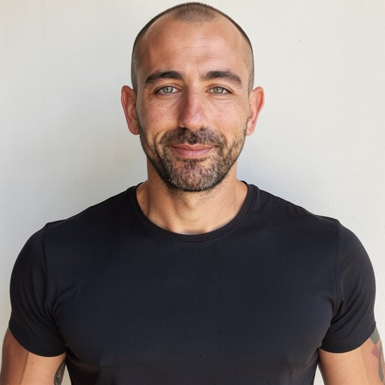
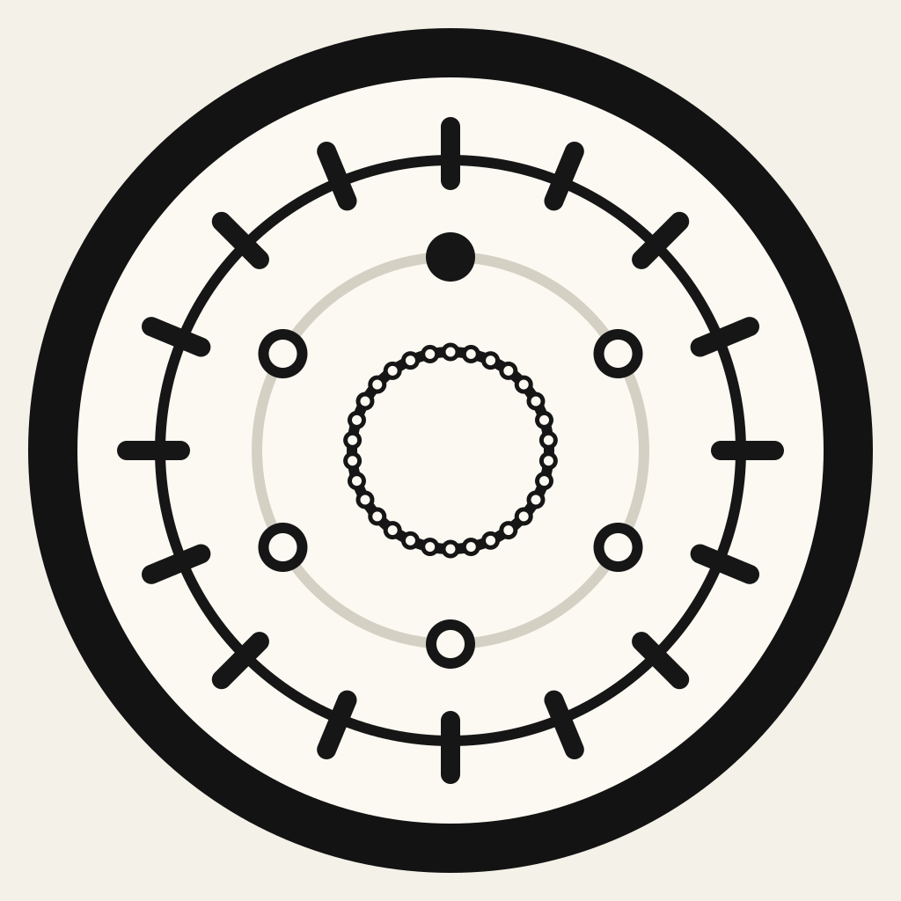

# Daniel Wahnich

AI systems engineer. Building [Nisayon](https://github.com/manfromnowhere143/nisayon).

I study how to diagnose failures, test corrections, and decide what the evidence supports.

 

## Selected work

 **Nisayon** · [Repository](https://github.com/manfromnowhere143/nisayon) · [Interface](https://nisayon.danielwahnich.dev) 
Experiments for diagnosing robot-policy integration failures and testing corrections on fresh conditions. The [Python SDK](https://github.com/manfromnowhere143/nisayon/blob/main/docs/QUICKSTART.md) retains replayable evidence; savings in total engineering work remain unproven.

Contributed shared-weight and processor fixes to [LeRobot’s Long-WAM integration](https://github.com/huggingface/lerobot/pull/5008).

**Atlas** · Private development 
An agent execution and evidence system studying when to execute, verify, repair or stop. Comparative benefit remains unproven.

 **Telos** · [Repository](https://github.com/manfromnowhere143/telos) · [Interface](https://telos.danielwahnich.dev) 
Research on coding-agent patches that pass graded tests but fail additional checks. Findings remain limited to the tasks and reference implementations studied.

 **Sentinel** · [Repository](https://github.com/manfromnowhere143/sentinel) · [Interface](https://sentinel.danielwahnich.dev) 
Runtime monitoring and recovery around frozen driving planners. Closed-loop studies report benchmark gains, intervention costs and null transfer.

 **Reiyah** · [Repository](https://github.com/manfromnowhere143/reiyah) · [Interface](https://reiyah.danielwahnich.dev) 
An offline engine for comparing perception systems under incomplete or disputed reference evidence. Returns checked loss bounds; reduced total effort remains unproven.

 **Inbar** · [Repository](https://github.com/manfromnowhere143/inbar) · [Interface](https://inbar.danielwahnich.dev) 
Research on diagnosing physical causes through tests that distinguish competing explanations. No physical result has been established.

 **Odeya** · [Repository](https://github.com/manfromnowhere143/odeya) · [Interface](https://odeya.danielwahnich.dev) 
Architecture for a research engine linking questions, evidence and separately assigned verification. Contracts and fixtures exist; the engine is not built.

 **Aweb** · Earlier work · [Website](https://aweblabs.ai) 
Governed AI-agent orchestration, connecting tools, durable workflows and operator approvals.

## Elsewhere

[Website](https://danielwahnich.dev) · [LinkedIn](https://www.linkedin.com/in/danielwahnich)
